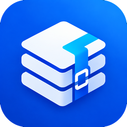

[README.md](https://github.com/user-attachments/files/34076164/README.md)
<div align="center">



# ShredPack

**An open-source archive tool for Windows. Extract, test and create archives with a built-in engine.**

[Download](https://github.com/Kchecksfiles/ShredPack/releases) &nbsp;·&nbsp; [Report a problem](https://github.com/Kchecksfiles/ShredPack/issues) &nbsp;·&nbsp; [Right-click menu](#right-click-menu) &nbsp;·&nbsp; [Extract & Free Space](#extract--free-space)


</div>

---

## What it is

ShredPack is a small desktop utility for people who just want to open, check and make archives. It is a convenient alternative to tools such as WinRAR: it does the work **itself**, so it does not need WinRAR or 7-Zip installed and never launches another program to do the job.

It is MIT-licensed. The code contains no ads, no accounts and no licence checks. It runs only when you open it or pick one of its right-click options; it does its job and exits, and nothing stays running in the background.

<!--
SCREENSHOTS - add real ones, then uncomment this block (see assets/screenshots/README.md):

<p align="center">
  
  
</p>
<p align="center">
  
  
</p>
-->

## Features

| | |
|---|---|
| **Extract** | Drag an archive onto the window, press **Extract**, or right-click it in Explorer. |
| **Browse & pick** | Open an archive's contents, search them, and extract only what you select. Optional wildcard filters such as `*.jpg`. |
| **Test** | Verifies every file (checksums and decompression) without writing anything. |
| **Create** | ZIP, 7Z and TAR variants, with levels and passwords (ZIP/7Z). Right-click any file or folder, or use **Create**. |
| **Checksums** | SHA-256, SHA-1, MD5 and CRC32 of any file, with a box to compare against a published value. |
| **Extract & Free Space** | Extract an archive, then delete the original to get the disk space back. A separate, confirmed action. [Details](#extract--free-space) |
| **Finish sound** | An optional short sound when a task finishes (Settings). |
| **First-run tour** | Three short cards on first launch. Skippable, shown once. |

Extraction is staged in a temporary folder first, so a failed or cancelled run leaves nothing behind. File names are sanitised (`..`, absolute paths, reserved Windows names and invisible text-direction characters are neutralised), existing files are only overwritten if you choose that in Settings, and symbolic links in archives are never created.

## Supported formats

| Format | Extract | Create | Notes |
|---|:---:|:---:|---|
| ZIP | yes | yes | Password-protected ZIPs (including AES); split ZIPs (`.z01` + `.zip`, `.zip.001`) |
| 7Z | yes | yes | |
| TAR, TAR.GZ/TGZ, TAR.BZ2, TAR.XZ | yes | yes | |
| GZ, BZ2, XZ (single file) | yes | no | |
| **RAR** | **yes** | **no** | RAR3 and RAR5. See [RAR](#rar) below. |
| ISO | yes | no | |
| CAB | yes | no | Stored and MSZIP only (not LZX/Quantum); multi-part cabinets unsupported |
| XAR | yes | no | |

**Not supported:** WIM, DMG, VHD/VHDX. ShredPack can **read** RAR archives but **cannot create** them.

### RAR

RAR extraction uses [`unrar-cffi`](https://pypi.org/project/unrar-cffi/), a binding to RARLAB's UnRAR source code. That licence allows free redistribution for extraction and forbids using the code to create RAR archives, which ShredPack never does. What has been checked, using sample archives:

- RAR3 and RAR5 archives, solid archives, nested folders and non-ASCII names
- Password-protected files: asks for the password, reports a wrong one, extracts with the right one
- Damaged and truncated archives fail with a message and leave no partial output
- Multi-part sets: open the **first** part (`.part1.rar`) with all parts in the same folder; opening a later part explains this

Limits: archives that encrypt their **file names** can't be opened, and **Extract & Free Space never deletes multi-part RAR sets**. The RAR checks above were run on Linux; the Windows build compiles the library during the GitHub Actions build. If that step ever fails, the build is produced without RAR and the app says *"RAR support isn't included in this build"* instead of failing.

## Install

**Installer (recommended).** Download `ShredPack-Setup.exe` from [Releases](https://github.com/Kchecksfiles/ShredPack/releases) and run it. It installs for your user (no administrator rights needed unless you choose an all-users install), can add the right-click menu, and adds an entry to *Settings > Apps* for uninstalling. Uninstalling removes the right-click entries ShredPack created.

**Portable.** Download `ShredPack.exe` and run it anywhere. On first launch it offers to add the right-click menu; if you say no, it won't ask again. The portable file unpacks itself on each start, so the installed app opens a little faster.

Each release also lists `SHA256SUMS.txt`. To verify a download:

```powershell
Get-FileHash .\ShredPack-Setup.exe -Algorithm SHA256
```

> **SmartScreen:** the builds are not code-signed, so Windows may show "Windows protected your PC" the first time. Choose *More info > Run anyway* if you trust the source, and compare the checksum above.

## Getting started

1. **Open ShredPack.** On the first launch a three-step tour appears under the buttons. Press **Next** twice and **Done**, or **Skip tour**. It does not come back unless you ask for it in **Settings**.
2. **Extract:** drop an archive on the big box, or press **Extract** and choose one.
3. **Choose where it goes** (for *Extract files*), tick any filters, and press **Extract**. Use **Browse** first to look inside, or **Test** to verify without extracting.
4. **Create:** press **Create**, add files or a folder, pick a format, and press **Compress**.
5. **Settings** (top right) controls what happens to files that already exist, whether *Extract Here* starts immediately, and the finish sound. Changes save automatically to `%APPDATA%\ShredPack\settings.json`.

## Right-click menu

Right-click an **archive** in Explorer:

| Entry | What it does |
|---|---|
| **Extract files...** | Opens the options screen so you choose the destination |
| **Extract Here** | Starts at once, into a new folder named after the archive, next to it |
| **Extract to `<archive name>\`** | Extracts into a folder named after the archive |
| **Open with ShredPack >** | A submenu: **Extract & Free Space...**, **Test archive**, **Add to ZIP**, **Add to archive...** |

Right-click any **other file or folder**: **Open with ShredPack >** **Add to ZIP** / **Add to archive...**.

Things to know:

- The third entry reads literally `Extract to <archive name>\`. A registry-based Windows menu can't show each archive's real name; that would need a compiled shell extension, which ShredPack doesn't install. Today it does the same thing as *Extract Here* (a new folder named after the archive). Inside the app, the options screen shows the real name (for example `Extract to Backup\` for `Backup.tar.gz`).
- On Windows 11 the entries are under **Show more options**.
- The menu works on **one selected item at a time**. To combine several items into one archive, use **Create** or drag them onto the window.
- The entries are registered for your user account only (nothing needs administrator rights). The installer registers them and removes them on uninstall. They are stored in the registry, so they stay across restarts.
- From the command line: `ShredPack.exe --install` registers the menu and `ShredPack.exe --uninstall` removes only ShredPack's own entries.

## Extract & Free Space

*Extract, then delete the original archive to reclaim disk space.* It is a **separate action**: ordinary extraction never deletes anything. It does not compress anything and does not make the extracted files smaller; it only removes the archive once you have the files.

Find it as the **Extract & Free Space** button on the options screen, or in the right-click menu under **Open with ShredPack**. From the right-click menu the files go into a new folder named after the archive.

**What it does, in order**

1. Shows a warning that the archive will be **permanently deleted** (not sent to the Recycle Bin, because a Recycle Bin copy would free no space) and asks you to confirm. The default answer is *No*.
2. Extracts **everything** in the archive. It refuses to run with a selection or filters, because the rest of the archive would be lost.
3. Checks the result. The archive is deleted **only if every check passes**:
   - extraction finished without error and was not cancelled
   - the archive contained at least one file, and every file was written and is present
   - where the format lists file sizes, the sizes on disk match the archive's own listing exactly
   - no file was skipped because one with that name already existed
   - the archive did not change (size and modified time) while it was being extracted
   - the extraction did not overwrite the archive itself, and the archive is a normal file, not a link
   - it is not part of a multi-part RAR set
4. If any check fails, the **archive is kept** and you are told why. If everything passes but the delete itself fails (for example the file is open in another program or read-only), **the extracted files are kept** and you are told that the archive couldn't be deleted.
5. Split ZIPs: all parts are deleted together, or none.

The check is only as deep as the format's reader allows: it confirms every file was decompressed and written without error and is present on disk. It does not compare the extracted files byte-for-byte against another source.

The older **Settings > Delete the original archive after a successful extraction** option is a different feature: it is off by default, sends the archive to the Recycle Bin when possible, and does not run the checks above. If you want the safeguards, use Extract & Free Space.

## Requirements and compatibility

- **Windows.** The release is built on GitHub's `windows-latest` runner; the project doesn't publish a tested-versions list, so none is claimed here. The window uses a dark title bar where Windows supports it.
- No installation of WinRAR, 7-Zip or other tools is needed. Everything the app uses is bundled in the release.
- Disk space: ShredPack warns before extracting an archive that looks like a decompression bomb or won't fit on the destination drive.
- Network: when you open the app directly it fetches one small version file from GitHub to show an "update available" link. Right-click actions don't. The code makes no other network requests. Errors are logged locally to `%APPDATA%\ShredPack\log.txt`.

## Troubleshooting and FAQ

**The right-click entries are missing.** On Windows 11, look under *Show more options*. If they're still missing, run `ShredPack.exe --install` (or re-run the installer and keep *Add ShredPack to the right-click menu* ticked). If you declined the first-launch prompt in the portable exe, `--install` is how to add them later.

**"RAR support isn't included in this build."** That build was produced without the RAR component. Use the official release, or see the build notes below.

**A RAR archive asks for a password forever / says file names are encrypted.** Archives that hide their file names can't be opened by ShredPack. Ordinary password-protected RAR files work.

**A RAR opens but says "later part of a multi-part set".** Open the first part (`name.part1.rar`) with every part in the same folder.

**Extract & Free Space kept my archive.** The message names the reason (partial extraction, a skipped file, the archive changed, a multi-part RAR, and so on). Nothing was deleted; the extracted files are in place.

**Can ShredPack create RAR files?** No. It only extracts RAR.

**Where are my settings and the log?** `%APPDATA%\ShredPack\settings.json` and `%APPDATA%\ShredPack\log.txt`.

**How do I see the tour again?** Settings > *Show the quick tour again* (button).

**Windows says "protected your PC".** See the SmartScreen note under [Install](#install).

## Known limitations

- The right-click menu text is fixed and works on one selected item at a time (see above).
- Executable bits and ownership aren't restored (they don't exist on Windows).
- Browsing split archives and previewing files are not implemented.
- The right-click menu, the Windows installer and the redesigned interface can only be fully exercised on Windows; the automated tests run on a stand-in for the registry and for Tk.

## Build from source

```bat
pip install py7zr pycdlib pyzipper tkinterdnd2 send2trash unrar-cffi pyinstaller
:: portable single file -> dist\ShredPack.exe
pyinstaller --noconsole --onefile --icon=shredpack.ico --add-data "shredpack.ico;." ^
  --collect-all py7zr --collect-all pycdlib --collect-all pyzipper --collect-all tkinterdnd2 ^
  --hidden-import unrar.cffi.unrarlib --hidden-import unrar.cffi._unrarlib --hidden-import _cffi_backend ^
  --name ShredPack shredpack.py
:: the app the installer ships (a folder, opens faster) -> dist-app\ShredPack\
pyinstaller --noconsole --onedir --noconfirm --distpath dist-app --workpath build-app ^
  --icon=shredpack.ico --add-data "shredpack.ico;." ^
  --collect-all py7zr --collect-all pycdlib --collect-all pyzipper --collect-all tkinterdnd2 ^
  --hidden-import unrar.cffi.unrarlib --hidden-import unrar.cffi._unrarlib --hidden-import _cffi_backend ^
  --name ShredPack shredpack.py
```

`unrar-cffi` is optional: leave it out (and its three `--hidden-import` flags) and the build simply has no RAR support. PyPI has no prebuilt Windows wheel of `unrar-cffi` for current Python versions, so `pip` compiles it and needs the Visual C++ build tools.

The installer is built from `setup.iss` with [Inno Setup](https://jrsoftware.org/isinfo.php): `ISCC.exe /DMyAppVersion=x.y.z setup.iss` (x.y.z = `APP_VERSION` in `shredpack.py`). The installer calls `ShredPack.exe --install` after copying files and `--uninstall` before removing them; the app icon is `shredpack.ico`.

### Releases

`.github/workflows/build.yml` runs the tests, builds the portable `ShredPack.exe` and the installer `ShredPack-Setup.exe`, writes and verifies `SHA256SUMS.txt`, and uploads the three files as the `ShredPack-release` workflow artifact. It attaches them to a version release (`vX.Y.Z`) only when asked:

- **Pushes to `main`, pull requests, and manual runs with `publish` unticked (the default):** test build only. Nothing is published and no tag or release is created or changed.
- **Push a tag** such as `v1.2.0`: the tag must equal `v` + `APP_VERSION` and point at the commit being built. The release is created if the tag has none; if it exists with no files, the three files are attached; if it already has files, the run fails.
- **Actions > Build ShredPack > Run workflow** (on `main`) with `publish` ticked: the same rules. A missing tag fails unless `create_tag` is ticked; existing files are replaced only if `overwrite` is ticked; a draft release is refused.

`VERSION.txt` must equal `APP_VERSION` (it drives the in-app update link), so change both together.

## Tests

```
python tests/test_shredpack.py       # engine: formats, RAR, selection, links, integrity, Extract & Free Space checks, menu registration
python tests/ui_smoke.py             # drives the UI logic with stand-in widgets
python tests/test_ui_event_loop.py   # the app inside a stand-in Tk event loop (incl. right-click launches)
```

The tests need only the standard library. With `py7zr` and `unrar-cffi` installed, the 7Z and RAR tests run too; without them those tests are reported as skipped.

## Contributing

Issues and pull requests are welcome at [github.com/Kchecksfiles/ShredPack](https://github.com/Kchecksfiles/ShredPack). Please run the three test files above before opening a pull request.

## Licences

ShredPack is MIT-licensed; see `LICENSE`. The release bundles third-party packages (`py7zr`, `pycdlib`, `pyzipper`, `tkinterdnd2`, `send2trash`, and `unrar-cffi` with the UnRAR source) under their own licences; check each project's current terms before redistributing binaries. The RAR test archives in `tests/rar_samples.py` come from the [rarfile](https://github.com/markokr/rarfile) project (ISC licence).
